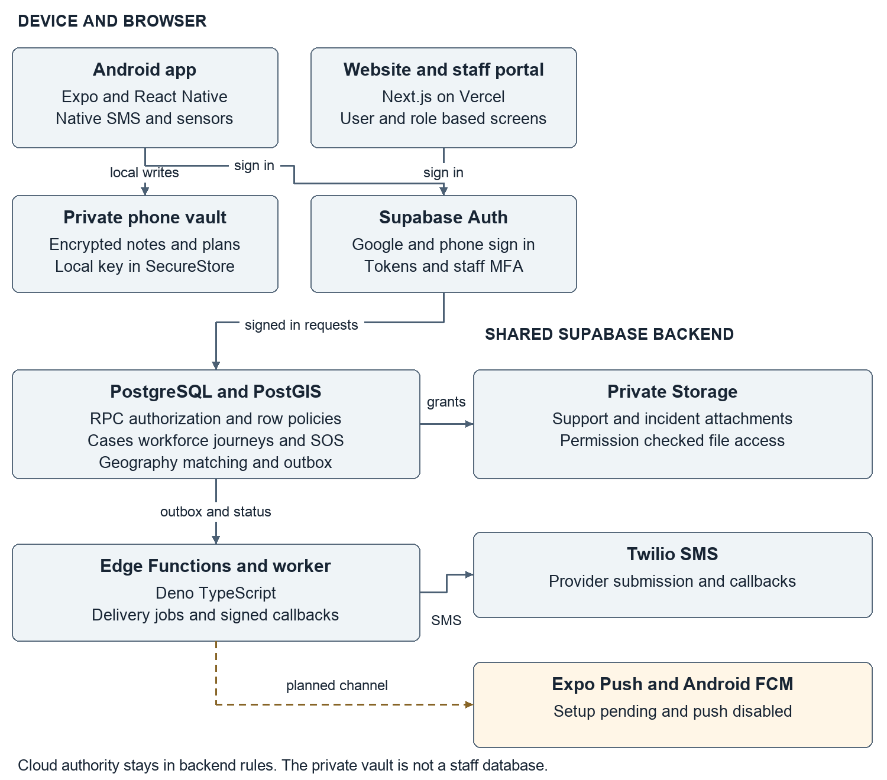
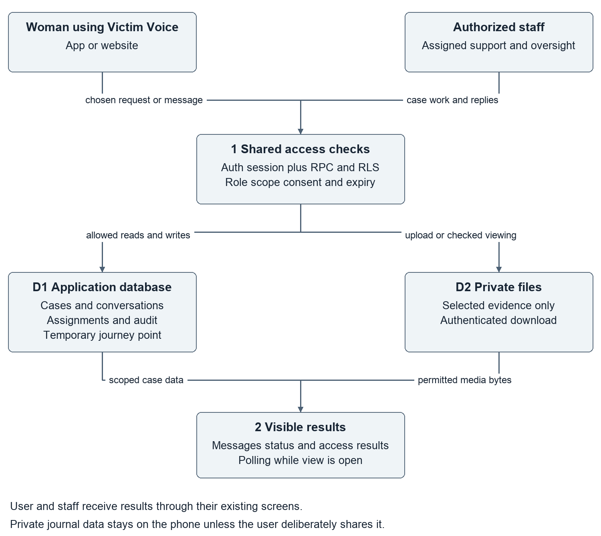
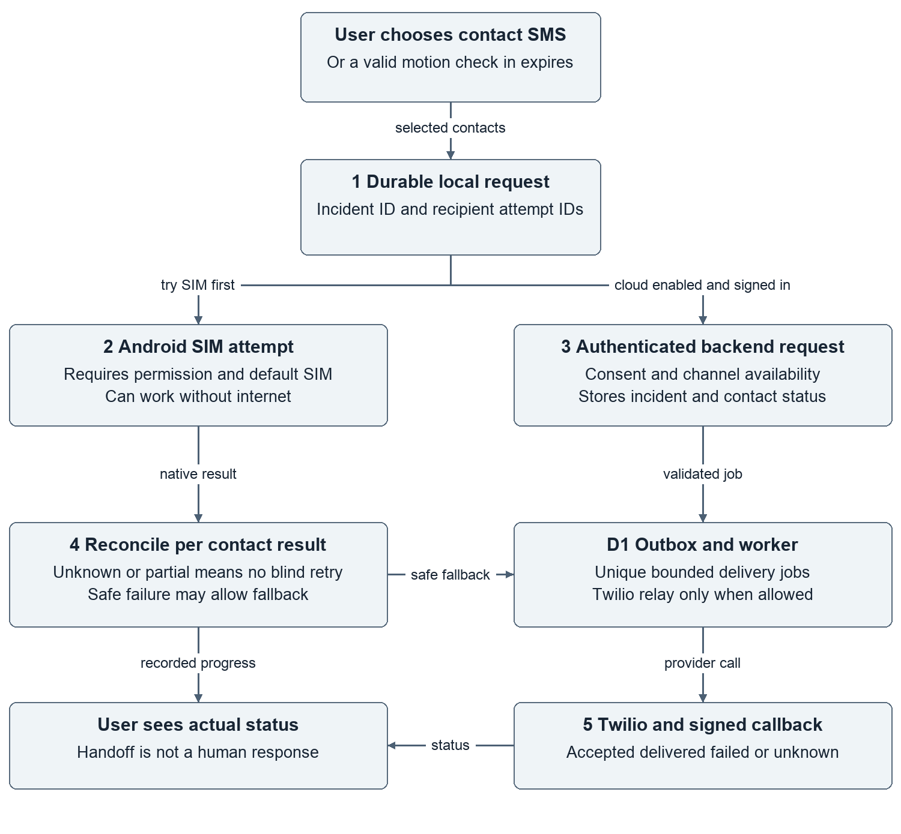
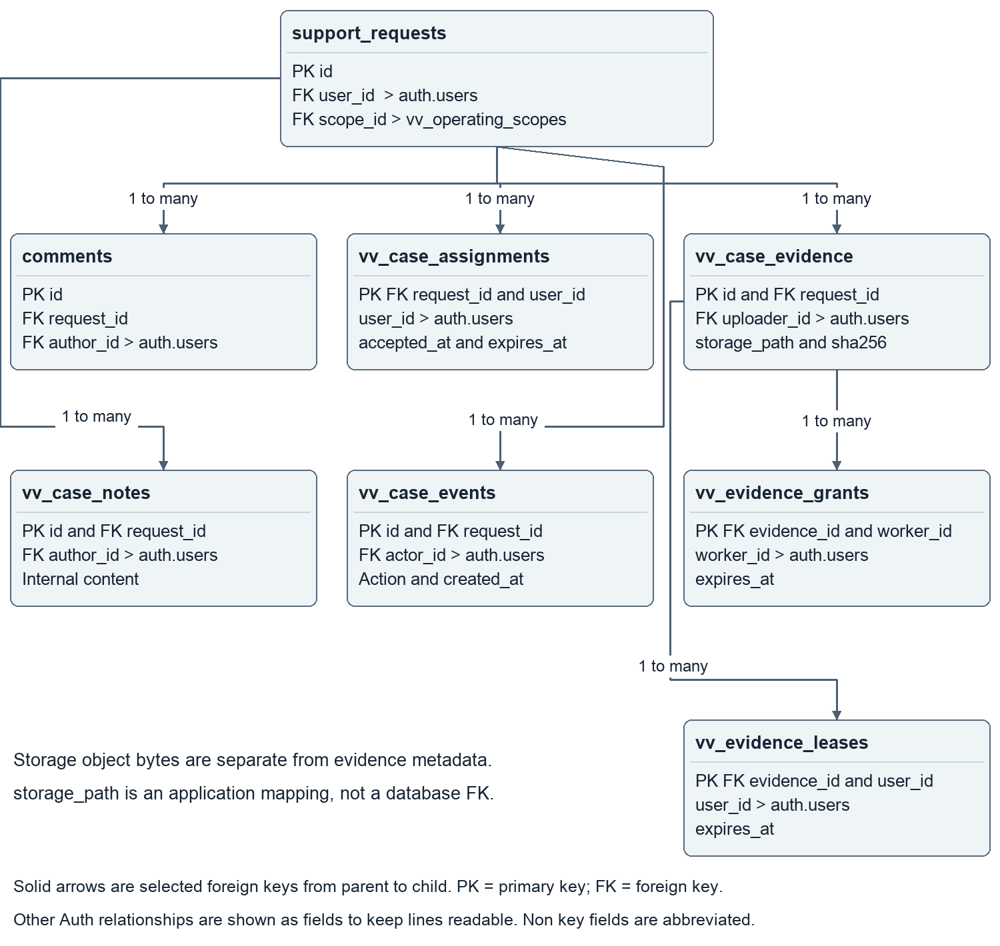
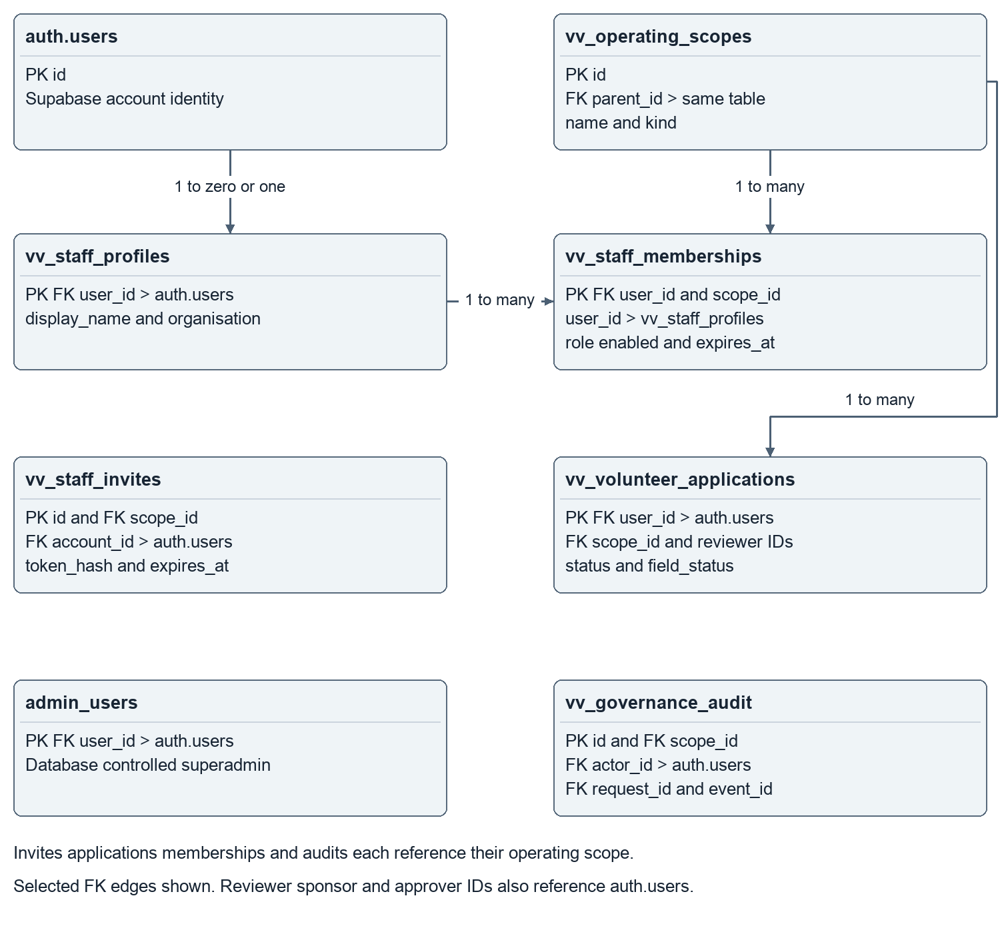
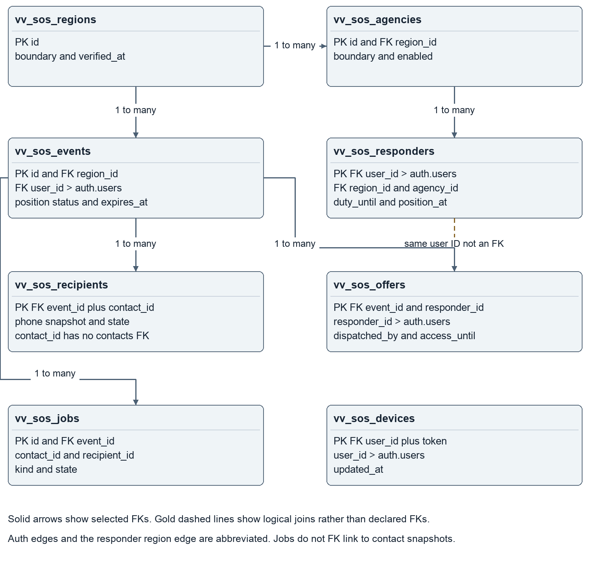
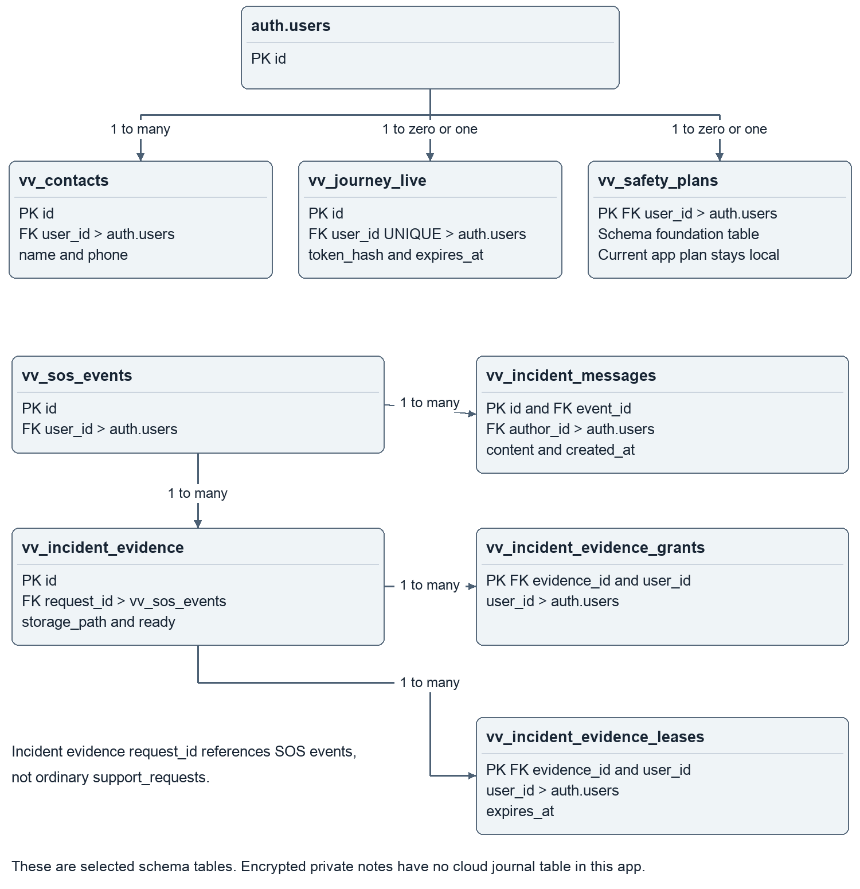

# Victim Voice Product and Architecture Guide

A practical explanation of the purpose, technology, features and intended impact

Product status on 12 November 2026 | Android pilot version 1.2.2

**Find the diagrams:** sections 19 to 25. **Use the app:** sections 26 to 28. **Use the support admin panel:** section 29. **Use Team and access:** sections 30 and 31.

## 1 What is Victim Voice

Victim Voice is a safety companion for women. It brings preparation, trusted contacts, help actions, private records and conversations with support workers into one product. It is designed to be useful before an incident, during a worrying situation and afterward, when someone may need time, information and continued support.

The mobile app is the main product. The website introduces Victim Voice, provides browser access to support and opens shared journey links. The staff portal gives authorized people a place to manage support conversations, personnel, volunteer applications and emergency coordination. These surfaces use one shared backend, so a submitted support request is part of the same system whether it is opened from the app or website.

A woman does not need to write a formal report to find the product useful. She can save a trusted contact, prepare a safety plan, read a guide or keep a private note. If she chooses to ask for support, she decides what to share. A private journal entry is separate from a submitted support case.

### What the product does today

The Android pilot includes Google and phone sign-in, trusted contacts, direct contact-message attempts, an optional attention sound, foreground motion check-ins, journey tools, private notes and a messaging-style support inbox. The backend provides private file storage, access rules, workforce controls, delivery jobs and geographic matching foundations. Some capabilities still need device testing or operational setup before they can be relied on in real situations.

Victim Voice cannot guarantee that an alert arrives, that a helper is available or that harm will be prevented. A saved request, an accepted message and a human response are different events. The interface and operating team need to keep those differences clear.

### How to read the status descriptions

**Implemented** means the capability exists in the current software. **Needs validation** means important real-device, hosted-account or delivery tests remain. **Needs setup** means credentials, reviewed geography, trained people or receiving services are missing. **Future** means an intended capability beyond the current pilot. These descriptions can overlap: software can be implemented while the service behind it still needs setup.

<!-- page -->
## 2 Vision goal and objectives

### Vision

The vision is to become a complete safety guide and companion for women: helping them feel supported in daily life, reach appropriate help during an unsafe situation, share what happened on their own terms and continue receiving support afterward. The first market is India. Later expansion should adapt the same foundation to each country's languages, resources, emergency services and operating arrangements.

The website provides visibility and quick access. The app keeps useful actions close at hand. One tap away is a design goal for reaching an action; phone locks, permissions, network conditions and system confirmations still affect what can happen next.

### Goal

The main goal is to reduce the effort and uncertainty involved in preparing for safety, contacting trusted people and finding accountable human support. The product should give a woman understandable choices and control over her information. It should also give support workers a clear, supervised way to help without exposing unnecessary personal data.

### Objectives

1. Make urgent help easy to find, including for people who have not signed in.
2. Help users prepare a trusted circle and a personal plan before they need them.
3. Provide a private way to record events without automatically submitting them to staff.
4. Make support feel like a conversation, with messages and attachments in the same place.
5. Show what was attempted, sent, delivered or acknowledged without inventing success.
6. Limit staff and volunteer access by role, area, assignment, purpose and time.
7. Let users stop location sharing and withdraw access to sensitive material.
8. Build an affordable pilot with usage limits, while treating SMS and human staffing as separate costs.
9. Validate safety functions on actual devices and with consenting recipients before making service promises.

### What success means

Success begins with practical tasks: a woman can find Get help quickly, contact someone she chose, understand whether a message was confirmed, and continue a support conversation without repeatedly explaining everything. She can also see who has access and remove that access when appropriate.

A complete service needs people as well as software. Clear response hours, trained staff, trusted local partners and a process for complaints are part of achieving the vision. A dashboard does not create a monitored response service on its own.

<!-- page -->
## 3 Technology stack and overall architecture

Architecture describes the main parts of the system, how they communicate and where responsibility sits. Victim Voice has three user-facing surfaces and a shared cloud backend. Some private information stays on the phone; information deliberately submitted for support is stored in the backend.

| Part | Main technology | Purpose |
| --- | --- | --- |
| Mobile app | Expo SDK 58 React Native 0.88 React 19 TypeScript | Android screens and access to phone capabilities |
| Mobile navigation | Expo Router | Screen routes and app callback handling |
| Local private storage | AES GCM AsyncStorage Expo SecureStore | Encrypted device data and protected encryption key |
| Website and staff portal | Next.js 15.5 React 18 TypeScript | Public pages browser support and staff workspaces |
| Website interface | Tailwind CSS Radix UI Lucide | Layout accessible controls and functional icons |
| Identity | Supabase Auth Google OAuth phone OTP staff TOTP MFA | Sign-in sessions and additional staff verification |
| Application data | Supabase PostgreSQL SQL functions row level security | Records permissions assignments and workflows |
| Files and geography | Supabase Storage PostGIS | Private attachments and geographic matching |
| Delivery services | Supabase Edge Functions Twilio Expo Push FCM | SMS processing and the planned Android push path |
| Hosting and releases | Vercel GitHub Expo Updates Android build tools | Website deployment source control APKs and compatible updates |

### How the parts connect

```text
Android app                 Website and staff portal
    |                                  |
    +----------- Supabase Auth ---------+
    |                                  |
    +---- Signed in requests and permission checks ----+
                                                       |
                              PostgreSQL functions and policies
                                  |                |
                              Private files    Delivery outbox
                                                       |
                                              Edge Functions
                                                |        |
                                             Twilio   Expo Push
                                                        |
                                                Firebase Android

Phone only private vault stays separate from shared support data
```

The app and website can call allowed Supabase operations directly. Database rules check the signed-in person before returning private data. Operations involving provider secrets, such as Twilio requests, run in server-side Edge Functions. The website is not a required middle step for every app request.

<!-- page -->
## 4 Mobile app architecture explained

### Screens and navigation

Expo Router maps route files to screens. The four main areas are Home, My Circle, Guide and My Space. Additional routes open help, journey controls, settings, support cases, responder tools and sign-in callbacks. Reusable screen components and shared controls keep buttons, text, spacing and navigation consistent.

For a user, this means the same product language and controls appear across the app. For a developer, the route files decide which screen opens while components hold most of the screen behavior. A navigation route does not grant permission to read a case; the backend makes that decision.

### App state and the private vault

AppState holds the current session and the user's saved local state. It coordinates contacts, notes, plans, preferences and active safety activities. The storage layer encrypts native data before writing it to AsyncStorage, which is the phone's application storage library.

The encryption uses AES GCM with a random device key and a fresh random nonce for each write. A nonce is a value that helps make repeated encryption safe. The key is kept in Expo SecureStore rather than beside the encrypted notes. AES GCM also detects changes to encrypted content. Account-aware storage and session-bound requests help avoid carrying one account's work into another account.

For the user, private notes are not automatically a cloud backup. Losing the device or uninstalling can make device-bound notes unrecoverable. The browser preview keeps its private state in memory and does not offer the same persistence as an installed APK.

### Phone capabilities

Expo modules provide location, accelerometer readings, local device authentication, file picking, sound, video, screen protection and update checks. A separate Android module, written in Kotlin, handles direct SIM SMS and records send attempts. Android WorkManager also supports bounded reporting of native SMS outcomes to the backend. This native code is why some changes require a new APK rather than an over-the-air update.

### Coordinators and foreground behavior

Small coordinator components manage ongoing work such as SMS progress, motion check-ins and live journey updates. They react to the app becoming active or moving to the background. This helps prevent stale work from continuing silently after a user leaves a screen or changes account.

Several safety functions currently depend on the app being open. Motion detection and live journey uploads are not dependable locked-phone background services in this pilot. That limitation must remain visible in the app and in demonstrations.

<!-- page -->
## 5 Website and staff portal architecture explained

### Public and user areas

The Next.js website contains the public home and about pages, sign-in, the user dashboard, support requests and the journey viewer. Vercel hosts the deployed website. Next.js builds the pages and browser code; React handles interactive forms and conversations after a page loads.

The user dashboard lets a signed-in person create and follow support requests. The journey page reads a temporary sharing token from the link fragment and asks the backend for the latest allowed location. It does not expose the user's support history.

### Staff routes

The staff portal is part of the same website and uses the same backend. Its routes organize responsibilities rather than creating separate identities or databases.

| Route | Purpose |
| --- | --- |
| /admin | Opens the home appropriate to the signed-in role |
| /admin/team | Personnel access invitations employee assignments and volunteer review |
| /admin/dashboard | Support inbox and case workspace |
| /admin/emergency | Emergency coordination response coverage and incident work |
| /admin/login | Staff Google or email and password sign-in |
| /join | Accept an account-bound staff invitation and set up MFA |
| /team | Compatibility entry for older bookmarks and installed app links |

A superadmin or area admin normally enters personnel management, an employee enters the support inbox, and an approved responder enters emergency work. Someone without a staff role cannot gain access by typing a staff URL. The database still checks every restricted operation.

### Sessions and sign-in returns

Browser sessions identify the account making requests. Sign-in return paths use an exact internal allowlist so the user can return to a staff invitation or appropriate workspace. Mobile Google sign-in returns through the Victim Voice app callback; website sign-in returns to a website callback. These are separate destinations and must both be configured correctly.

### Conversations and interface privacy

The support workspace separates the conversation, shared evidence, internal notes and activity. Messages refresh while the view is active, without requiring the user to reload the page. Hidden views stop polling and sensitive viewers recheck access.

Restricted routes use no-index, no-referrer and frame-denial headers. These reduce indexing and accidental disclosure but do not replace login, database authorization or responsible staff behavior.

<!-- page -->
## 6 Backend architecture explained

### Supabase Auth

Supabase Auth manages accounts, Google and phone sign-in, session tokens and staff multi-factor authentication. A session token tells the backend which account is making a request. The app does not decide its own permissions by sending a role name. Roles and delegated access are checked against backend records.

Phone login sends a one-time code through the configured authentication provider. This provider setup is separate from the Twilio setup used for safety messages. A working login OTP does not prove the SOS sender is configured or that safety SMS delivery works.

### PostgreSQL and controlled operations

PostgreSQL stores support cases, messages, assignments, staff memberships, volunteer reviews, journey sessions, SOS incidents and audit records. SQL functions expose specific operations such as accepting an invitation, opening a case or publishing a journey point. These are often called RPCs, meaning remote procedure calls.

Row-level security is a database rule system that decides which records an account may read or change. Some sensitive operations use tightly controlled functions that perform additional role, scope, consent, expiry and conflict checks. Function-level authorization matters as much as table policies. An elevated SQL function must authorize its caller explicitly.

### Private Storage

Supabase Storage holds deliberately shared files in private buckets. Database records describe the file, its owner, its case or incident, and who may open it. A file URL is not a public gallery link. Download access requires authentication and the relevant current permissions.

### Geography with PostGIS

PostGIS adds geographic operations to PostgreSQL. It can check whether a location falls inside a reviewed area and whether available responders match a response scope. An administrative state or city scope is different from a verified police jurisdiction. Uncertain location accuracy or overlapping boundaries should not produce a confident automatic dispatch claim.

### Edge Functions and the delivery outbox

Edge Functions run TypeScript on the Deno runtime. The SOS Edge Function handles authenticated requests and server-side provider calls. Delivery work is recorded in an outbox, a durable list of jobs. A worker claims a bounded number of jobs and records their results. A scheduled minute worker provides recovery if immediate processing is interrupted. It is a recovery mechanism, not a promise of an instant response.

The separate callback function validates Twilio's signature before accepting status updates. Provider credentials and the Supabase service-role key stay on the server. A public app key can be included in the client; secret provider or database credentials cannot.

<!-- page -->
## 7 Data privacy and responsibility

### Where information lives

| Information | Main location | Normal access |
| --- | --- | --- |
| Private notes and personal plan | Encrypted phone vault | The device user after configured local checks |
| Trusted contacts | Phone with optional chosen cloud backup | The owner and explicit safety-message processing |
| Support request and messages | Supabase database | Owner and currently authorized support staff |
| Support attachments | Private Storage with metadata | Owner and specifically permitted current staff |
| Journey location | Latest point in a temporary backend session | Owner and anyone holding the active sharing link |
| SOS contact and location snapshots | Restricted incident records | Authorized processing and limited assigned responders |
| Workforce verification references | Restricted staff records | Authorized reviewers and supervising roles |
| Audit activity | Backend audit records | Authorized participants or supervisors according to scope |

### Consent is specific

Signing in is not permission to share all private data. Saving a contact does not message that person. Starting a support case does not automatically upload the private journal. A responder role does not open support histories. Evidence access has its own grant, separate from being assigned a case.

Permissions can end through user revocation, a block, case closure, assignment expiry, loss of eligibility or staff suspension. Sensitive file viewers recheck current access. Revocation stops future authorized retrieval; it cannot erase information someone has already seen or copied.

### Protection and its limits

The native app requests screen-capture protection. The staff web viewer uses measures such as watermarks, hiding on blur and the absence of bulk export controls. Browsers cannot reliably prevent screenshots, and no application can prevent someone using an external camera. External document readers and deliberately exported copies are outside the app's control.

The phone vault uses local encryption. Shared support conversations are protected by server authorization and private storage, but are not implemented as end-to-end encrypted chat. Authorized staff and privileged infrastructure operators remain part of the trust model.

### Operational responsibility

Software checks can limit misuse and make activity accountable. They cannot prove that a volunteer is safe or guarantee future conduct. Actual identity review, reference checks, training, confidentiality agreements, complaint handling and supervision need named people and an operating organization. Review checkboxes record someone's attestation; they are not an automated background-check service.

<!-- page -->
## 8 Features for getting started and preparing

### Home and quick access

**For the user:** Home places Get help, journey tools, motion settings, support and trusted contacts close together. A person can start with core local tools and guidance without completing a profile. Android also offers a long-press launcher shortcut to Get help.

**Behind the scenes:** Expo Router opens the chosen screen and the common state layer supplies saved preferences. The shortcut opens the help route; it does not bypass a device lock, call emergency services or send a message by itself. The app should always describe the action that actually happened.

### Google and phone sign-in

**For the user:** Google login supports people who prefer not to use phone OTP. Phone login remains another option. The app keeps the session so repeated sign-in is normally unnecessary, and users can sign out or change accounts.

**Behind the scenes:** Supabase Auth issues and refreshes session tokens. Native Google login uses a browser session and PKCE, a method that binds the callback to the app that started sign-in. The configured app callback returns to Victim Voice. Staff accounts also need an authenticator code for privileged work. Google and phone login, persistent sessions and account switching were reported working by the owner; that does not validate every device or provider failure mode.

### My Circle and trusted contacts

**For the user:** Add, edit or remove people manually, choose a primary contact and select who should receive a safety message. Saving someone sends no invitation or alert. A trusted contact can receive an ordinary SMS without installing Victim Voice.

**Behind the scenes:** Contacts are saved in the local vault. Signed-in users can deliberately back up or restore their contacts through owner-restricted cloud records. Phone values are normalized and checked before sending. Safety jobs use a bounded selection of contacts rather than broadcasting to an unlimited list.

### Personal safety plan

**For the user:** Save places to go, useful information and steps that feel appropriate for a situation. Edit the plan as circumstances change. Preparing a plan does not notify family, staff or police.

**Behind the scenes:** The plan belongs to the private native vault and can be protected with device authentication. It is separate from support case data. This makes it useful offline, but means it is not automatically recoverable from the cloud after uninstalling.

<!-- page -->
## 9 Features for asking for urgent help

### Calling and a current location snapshot

**For the user:** Get help offers a deliberate emergency call action and ways to contact trusted people. A user can request a current location to include in a help message. If location is unavailable, it should be possible to proceed without it rather than block help.

**Behind the scenes:** The call action opens the phone's calling flow. It does not establish a direct digital integration with an emergency control room. Location acquisition checks permission and freshness and includes timing information. A single snapshot is different from a continuously updated journey link.

### Direct SIM SMS with Twilio fallback

**For the user:** After Safety message setup, Message my contact attempts to send directly to the selected people. The app first uses the phone's SIM when supported and allowed. If that path is definitely unavailable or fails in a way that permits fallback, an opted-in signed-in user can use backend SMS. A separate composer option remains available for manual sending.

**Behind the scenes:** A local SOS record contains stable incident and recipient attempt IDs. The Android SMS module records results, and the coordinator sends permitted progress to the backend. Twilio jobs use server credentials and a durable outbox. Stable IDs help avoid duplicate sends after retries or screen changes.

**Important boundary:** An unknown or partly successful SIM outcome must not trigger blind fallback. The person may already have received a message. Provider acceptance, carrier delivery and a human reading the message are separate states. SMS fees depend on the SIM plan or provider; Supabase's Free plan does not make messages free. Twilio relay is configured in the recorded hosted setup, but actual safety-message delivery still needs controlled recipient tests.

### Attention sound

**For the user:** Start a noticeable sound when attracting bystanders is useful and stop it when it is no longer wanted. Quiet behavior matters in situations where noise could increase risk.

**Behind the scenes:** The app plays a bundled sound locally. Volume, hardware and device audio behavior affect what is heard. Playback stops when leaving the relevant screen or backgrounding. Sound is a separate action from SMS delivery; the current pilot should not imply that every SOS automatically produces a delayed siren.

<!-- page -->
## 10 Motion check ins and the journey companion

### Shake and drop check ins

**For the user:** Shake and drop alerts default on in Settings and can be turned off. When setup is ready and the app is active, a strong shake or a drop-like movement opens a 20-second check-in. The user can cancel or choose Send now. If the valid countdown expires, the existing safety-message flow is started.

**Behind the scenes:** An accelerometer reports acceleration. Shake recognition looks for three separate high and low pulses within three seconds. Drop recognition looks for sustained low acceleration followed by an impact. The monitor samples in the foreground and requires contacts, an alert name, usable SMS delivery and available sensor access. It uses cooldowns and an active-request guard to avoid repeated alerts.

A wall-clock deadline prevents a delayed timer from pretending it ran normally. Backgrounding, turning the feature off or changing account cancels monitoring or the pending check-in. A stalled countdown is discarded. Motion-triggered messages ask contacts to check on the person; the sensor does not determine that an assault, injury or emergency occurred. This path does not automatically collect location. Physical sensitivity and full delivery still need validation.

### Journey timer

**For the user:** Set an expected-arrival time, optionally add a destination, extend the time or finish the journey. It provides a visible check-in tool while using the app.

**Behind the scenes:** The deadline and journey state are saved locally. The screen compares the saved deadline with the current time. This is not a dependable closed-app missed-arrival dispatch system, and a late timer does not prove someone is in trouble.

### Live journey location

**For the user:** A signed-in person can start sharing and send a temporary web link to someone they trust. The viewer sees the latest position and when it was updated. Anyone with a forwarded active link can view it, so sharing the link is itself a privacy decision.

**Behind the scenes:** The owner creates an expiring session, and the server stores a hash of its bearer token. Only the latest point is retained. Updates run roughly every 15 seconds after completed work while the app is active and online. Sharing expires within 60 minutes; the viewer hides coordinates once a point is older than 45 seconds. Stopping or completing the journey queues revocation. If the phone is offline, server confirmation can be delayed; expiry still limits the link. Backgrounding or locking pauses uploads.

<!-- page -->
## 11 Guidance private records and offline use

### Safety guides and resource links

**For the user:** Browse or search short guides, choose categories and save useful material. Guidance covers situations and possible next steps rather than asking everyone to submit an incident report. Resource links help the user explore external help.

**Behind the scenes:** Introductory guides are bundled with the app, which makes them available without fetching each page from the cloud. Search and saved-item state run locally. External resource links leave the app and depend on the destination and internet connection. A bundled resource list does not establish a verified nationwide directory or an agreement that a service will respond.

The next service stage should give each directory entry an accountable reviewer, location, languages, hours, eligibility, cost information and review date. Reviewed Hindi and other language support remain future work. Safety, medical and legal guidance needs suitable human review before being presented as authoritative advice.

### Private incident journal

**For the user:** Write down what happened, keep dates and thoughts together, and decide later whether to share selected text. Notes can be useful even if the person is not ready to contact anyone. Deleting or exporting is a deliberate choice.

**Behind the scenes:** Notes are encrypted in the native local vault and are not automatically shown in the staff portal. Device authentication can guard private areas. A shared or exported copy is outside the vault's protection. Notes are a personal record; the software does not certify that an event happened or that a record will have a particular legal status.

### My Space and continued support

**For the user:** My Space keeps private notes, the personal plan and access to support journeys organized. The person can return at their own pace instead of being pushed into an immediate formal complaint.

**Behind the scenes:** The interface groups separate data types without giving them identical sharing rules. A support request is an explicitly submitted backend record; a local note remains local until the user deliberately shares something. Counseling bookings, legal representation and supervised recovery programs are future service capabilities requiring real providers.

### Offline essentials

**For the user:** Local contacts, notes, plans and bundled guides remain useful without internet. SIM texting and phone calls depend on cellular service, permissions and the device, rather than internet alone.

**Behind the scenes:** Local encrypted storage and bundled assets support offline access. Cloud conversations, new uploads, Twilio relay and live sharing need connectivity. A pending upload or queued local change must not be described as received by the backend. The whole product is not fully offline.

<!-- page -->
## 12 Support conversations and evidence

### Opening and following a support case

**For the user:** Start a support conversation from Home or My Space, describe the concern, review what will be shared and submit. The user can keep a local draft, return to the case and see its status. A submitted request is separate from a promise that someone is monitoring it immediately.

**Behind the scenes:** The backend records ownership, case information, messages and workflow status. A chosen operating area helps route work. Staff access depends on current role and case rules; the interface does not expose raw account contact details as a general directory.

### Messaging without manual refresh

**For the user:** Messages appear in chronological bubbles with a composer at the bottom. New replies can arrive while the conversation is open without the user refreshing. If sending fails, the draft stays available to retry.

**Behind the scenes:** A controlled polling loop checks roughly every five seconds after each completed fetch. It pauses when hidden, backgrounded, locked or signed out, and catches up on return. Failed checks back off. Pagination limits how much history is fetched. This is periodic checking, not a continuously open live socket; closed-app support-message push and read receipts are not implemented.

### Attaching files and links in the conversation

**For the user:** The paperclip opens attachment choices inside the conversation. Share selected photos, audio, video, supported documents or an HTTPS link without changing tabs. Optional evidence and privacy sections make it easier to find shared items and manage access later.

**Behind the scenes:** The client validates allowed types and budgets, creates private metadata, uploads to a random Storage path and finalizes the record. Supported documents include PDF, DOCX and plain text. A SHA-256 fingerprint checks whether a displayed copy matches the expected bytes; it does not establish authenticity or legal admissibility. Links are not fetched automatically for previews. Documents opened in another reader leave the app's protection.

### Separate permission to open evidence

The owner chooses which current employee or coordinator can open each item. A case assignment alone is insufficient. Opening uses an audited function and a short actor-specific lease, followed by an authenticated Storage download. Viewers recheck access and close when authorization is lost. Support evidence is limited to 10 MiB per file, 20 items and a 50 MiB budget per case, with an 800 MiB application cap for that bucket. These limits reduce resource use; no malware-scanning or forensic verification service is included.

<!-- page -->
## 13 Staff enrollment and case work

### Superadmin and area admins

**For people operating the service:** A database-controlled superadmin appoints verified area admins. Areas can represent a state, city or delegated service region. An area admin appoints employees inside their own authority; they cannot promote themselves to superadmin or widen their own area.

**Behind the scenes:** The bootstrap is the restricted admin_users database table. Staff profiles, memberships and scope relationships record delegated permissions. Database functions enforce that hierarchy and recheck whether sponsoring memberships remain valid. Suspending an admin also invalidates access that depends on that sponsor chain.

### Staff invitations and authenticator setup

**For the invitee:** Sign in, open /join, set up an authenticator and provide the account reference to the person making the invitation. After the organization's checks, the inviter creates a code and shares it privately. The invitee enters it at /join.

**Behind the scenes:** Invitations are account-bound, expire after seven days and can be used once. The product displays the code in a popup; it does not currently email or text it automatically. MFA checks are enforced on the backend. The authenticator QR encodes setup information and should be treated as sensitive. Staff memberships require review and renewal, with a 90-day limit in the current model.

### Employee assignment and oversight

**For the employee:** Mark availability, receive a local case assignment, acknowledge it and confirm no conflict before reading the case. Work through the support inbox, reply in the app's conversation, add internal notes and update case progress. Internal investigation notes are separate from messages visible to the user.

**Behind the scenes:** Availability lasts up to four hours and employees can hold at most five active cases. Acknowledgment is due within 15 minutes; access can last up to seven days and ends earlier on closure or revocation. Admins need a recorded purpose for sensitive oversight access, with a ten-minute lease. Legacy cases without an operating area need superadmin triage before normal regional assignment.

### Accountability and user control

Database-generated activity records assignments, opens, replies, access decisions and review actions. The user can manage evidence access and report or block staff. Scope and purpose restrictions reduce casual browsing, but privileged infrastructure access remains a trust responsibility. Logs live in the same database and are not an independently immutable external audit archive. Staffing, handover and investigation procedures still need an operating team.

<!-- page -->
## 14 Volunteers nearby response and police routing

### Volunteer application and approval

**For an applicant:** Sign in as an ordinary verified user, open Settings and Offer support, choose a pilot area and submit relevant details. The applicant can see the decision, correct information and request reconsideration. Applying does not reveal a victim or grant staff access.

**Behind the scenes:** A local employee takes the review, confirms no conflict and records identity, contact, references, interview, training, confidentiality and area checks. An independent local admin reviews field-response eligibility and records a supervision or buddy plan. Initial eligibility lasts at most 30 days and depends on the reviewers and approvers remaining valid. This process records human checks; no identity-verification vendor is integrated.

### Nearby responder notification and dispatch

**For the approved helper:** Set up MFA, register a receiving device and deliberately go on duty. A helper may acknowledge an offer, decline, withdraw or report that helping would be unsafe. Acknowledgment means willingness, not arrival or rescue.

**Behind the scenes:** Duty lasts 15 minutes and matching requires sufficiently fresh location and enabled reviewed geography. Push contains an opaque incident reference rather than victim details. A coordinator must give a short-lived dispatch grant before precise location and incident chat are available. Volunteers cannot read ordinary support cases or unrelated evidence. Helpers do not receive the survivor's callback number through responder views.

**Current boundary:** Android Firebase client configuration, Expo FCM credentials, a matching push-capable build, receiving teams and physical delivery tests remain necessary. Responder push is disabled in the recorded setup. Pilot regions alone do not establish nearby help coverage.

### In app incident communication

Incident chat is separate from long-term support chat. Current authorized participants communicate inside the app. Contact-detail pattern checks reduce accidental sharing of personal numbers or email, but cannot prevent disguised details. Incident attachments are explicitly shared with named participants; new participants do not inherit them automatically. Files are capped at 5 MiB each, 20 items and 20 MiB per incident, with a separate 100 MiB global incident-media cap.

### Police jurisdiction routing

Bhopal, Tripura and Bhubaneswar are the selected pilot scopes. Real automatic routing needs authoritative reviewed boundaries, verified agency accounts and an agreed monitored receiving process. PostGIS can assist that match; it cannot create police participation. No real police agency has been onboarded in the recorded setup, and automatic police alerts are unavailable. Ordinary emergency calling remains a separate user action.

<!-- page -->
## 15 Settings safety controls and product delivery

### Privacy and device settings

**For the user:** Settings provides account controls, motion preferences, safety-message setup, relevant device permission checks, private-area protection and volunteering. Permissions should be requested for the function that needs them. Refusing location should not remove access to basic guidance or the emergency call action.

**Behind the scenes:** Native modules read available sensor, location, SIM and device-security states. Missing permission, missing hardware and an unsupported browser are different conditions. SMS permission alone does not establish a usable default SIM. The app does not need to read the SMS inbox to send a chosen safety message.

### Blocking reporting and helper safety

**For the user and helper:** A survivor can report or block an involved person. A helper can decline a task, withdraw or report a safety concern without treating every withdrawal as misconduct. A real service needs a reachable complaints and escalation process for both sides.

**Behind the scenes:** Blocking removes access to the reporting survivor's relevant incident or case. Platform-wide suspension requires an accountable human decision. Role expiry, revoked assignments and loss of duty or eligibility also close access. Access control can reduce opportunities for misuse while protecting legitimate helpers from unnecessary exposure of personal contact information.

### Deletion and retention

The product includes account-deletion handling. Shared uploaded objects are removed through the Storage API before final account deletion, so deleting database rows does not silently leave originals behind. A failed file removal prevents completion and allows retry. This flow needs controlled hosted verification. Already exported files or copies held outside the system cannot be recalled.

SOS retention is separate from ordinary support-case retention. The pilot schedules cleanup of old contact snapshots, locations and incident chat after seven days, along with expired media cleanup. Support cases, workforce verification references, audits, exceptional investigations and backup retention need a documented operating policy. The seven-day incident cleanup must not be presented as a universal deletion promise for every kind of data.

### APK releases and over the air updates

The current shareable Android pilot is version 1.2.2. GitHub stores source and a private release containing the APK. Vercel hosts the website. Expo Updates can distribute compatible JavaScript and asset changes to matching app runtimes. Native modules, permissions, launcher icons and launch-screen configuration require an APK update. Runtime fingerprints prevent an incompatible update being applied to a different native build.

The approved helping-hands brand is used across the app, website and staff portal. Production store signing and iPhone validation remain separate release work. Installing over the existing app preserves the intended local-data continuity; uninstalling risks losing device-bound records.

<!-- page -->
## 16 How the system works in real situations

### Preparing before a journey

A user adds two trusted people, chooses the primary contact and completes Safety message setup. She reads a guide and saves a private plan. None of these preparation steps tells anyone she is in trouble. If she wants to share a journey, she starts a session and deliberately sends its link.

Technically, contact and plan changes are local vault writes unless she chooses a cloud contact action. Starting live sharing creates an expiring backend session. Only fresh points are published, and the viewer receives the latest allowed point. The support team does not automatically receive the link or gain access to the private plan.

### Asking a trusted person to check in

A user opens Get help and chooses to message selected contacts. The phone attempts SIM sending when configured. If that route is definitely unavailable or safely failed, consented backend fallback can be requested. The screen shows separate recipient outcomes and gives another route when a result cannot be confirmed.

Technically, each recipient has a stable attempt ID. Native results, backend outbox work and signed provider callbacks update the relevant states. An ambiguous result is retained as unknown rather than retried blindly. A carrier delivery result still does not prove the contact has read it or is coming to help.

### Receiving support after an incident

A user opens a conversation, shares a description and attaches only the evidence she chooses. An admin assigns an available local employee. The employee acknowledges the case and confirms no conflict, then replies in the same conversation. The user grants file access separately, can follow activity and can remove or report an involved worker.

Technically, request ownership, staff scope, assignment status, evidence grants and leases are checked on server requests. Polling refreshes the open conversation without clearing an unsent draft. Internal notes support handover but are not sent as user-visible replies. A volunteer application or emergency duty status does not give access to this support case.

### Asking for nearby help in a future operating pilot

When the receiving service is established, a consented SOS could offer work to eligible on-duty responders, then let a coordinator dispatch a selected helper. The user would see actual offer, acknowledgment and dispatch states. That story depends on validated delivery, reviewed geography and staffed supervision. It is not the current promise of an available nearby rescue network.

<!-- page -->
## 17 What the project can achieve

### Practical value from the current foundation

Victim Voice can bring several disconnected tasks into one understandable place: preparing a contact circle, keeping private records, asking a trusted person to check in, sharing a temporary journey link and following a support conversation. This can reduce repeated searching and repeated retelling. It can give a user more control over when information moves from her phone into a shared support process.

For an operating organization, the system can provide a common inbox, scoped assignments, human review records, purpose-limited oversight and evidence access controls. This creates a stronger basis for accountable assistance than sharing sensitive files and personal phone numbers informally. The controls need real supervision and regular review to produce that benefit.

### What becomes possible after validation and onboarding

A tested pilot with trained staff and consenting recipients could provide dependable support during clearly stated service hours. Reviewed local responders and agency arrangements could extend that service where coverage is real. Better language support, accessibility testing and low-connectivity behavior could make the product useful to more women across India.

Global expansion would require country-specific emergency resources, legal and privacy review, local staffing, language review and provider configuration. The shared app and backend make adaptation possible, but each country still needs its own operating arrangements. Software reuse does not transfer trust or response coverage automatically.

### Longer term capabilities

The broader plan includes reviewed multilingual guidance, a verified help directory, professional referrals, supervised recovery support and an iPhone release. Moderated community support, optional assistance for finding reviewed guidance, and wearable or lock-screen entry points are later possibilities. These are not completed pilot features. Each needs its own privacy design, human review and operating capacity. An optional automated guide must remain separate from urgent help and must not decide whether someone is in danger.

### How to measure progress

Measure whether users can find help actions, complete contact setup, cancel an accidental check-in and distinguish sent from delivered. Test offline, denied-permission, no-SIM, weak-network and locked-phone behavior. Record SMS outcomes by channel and measure how often unknown results occur.

For support, measure time to assignment, time to a first human reply, unresolved queues, repeated case transfers, user-reported problems and whether evidence revocation works. For helpers, measure training completion, overdue reviews, duty freshness, withdrawals and safety complaints. Set response targets only after capacity and hours have been established; the current pilot has no guaranteed response time.

### Boundaries of the outcome

The project can improve access, continuity and accountability. A reduction in harm would require evidence from a responsibly evaluated real-world service. The app cannot guarantee physical safety, identify every unsafe volunteer or replace emergency services, legal professionals or healthcare. Product success should include user control and helper safety, alongside the speed of reaching assistance.

<!-- page -->
## 18 Priorities costs and reference notes

### Priorities before a wider public pilot

1. Test the existing APK on consenting physical single and dual SIM devices, including permission denial, network loss, backgrounding, app restart and delivery uncertainty.
2. Complete Firebase and Expo FCM setup, build the matching APK and validate private push with controlled receiving accounts before enabling it.
3. Onboard trained staff, establish service hours and define escalation, handover, supervision and complaint handling.
4. Review response geography and receiving agencies. Keep unsupported areas and police routing visibly unavailable.
5. Run hosted multi-account checks for assignments, revoked roles, file access, blocking, account switching and deletion with disposable test data.
6. Review guides, translations, accessibility, privacy policy, retention and store-release requirements. Validate iPhone separately before promising parity.

### Cost and capacity

The intended backend budget starts with Supabase's Free plan. The application uses pagination, visible-screen polling, storage budgets, time-limited sharing and bounded delivery work to control consumption. Current pilot relay controls include up to five selected contacts, three incidents per account per day and 50 global relay attempts per day. These are application limits, not proof that every external quota will remain free.

Database size, file storage, downloads, Edge Function usage, Auth activity and push infrastructure need monitoring. SMS provider charges, carrier charges and staff costs are separate. The private evidence bucket budget does not include every other kind of file or database record. As use grows, measure actual consumption and either reduce scope or fund capacity before making broader service commitments.

### Plain language glossary

**Backend:** the cloud services that store shared records and enforce rules. **API:** a defined way for the app to ask a service to do something. **RPC:** a named database operation called from the app. **RLS:** database rules restricting access to individual rows. **MFA:** a second sign-in check, such as an authenticator code. **Outbox:** saved work waiting to be processed. **Lease:** temporary permission that expires. **PostGIS:** database tools for geographic checks. **OTA:** an update delivered without replacing the whole APK. **FCM:** Firebase Cloud Messaging, part of Android push delivery. **Bearer link:** a link whose holder can use its temporary permission.

### Project reference map

The vision is recorded in PRODUCT.md. Current operational roles and boundaries are described in docs/WORKFORCE_OPERATIONS.md and docs/SCOPED_WORKFORCE_MODEL.md. Mobile implementation and release notes are in mobile/FEATURES.md, mobile/QA.md and mobile/UPDATES.md. Older planning and overview files contain earlier descriptions; later feature and workforce updates supersede them.

Core implementation areas are mobile/src/components and mobile/src/lib, app and components for the website, and supabase SQL plus supabase/functions for backend rules and delivery. package.json, mobile/package.json and mobile/app.json record the technology and native build configuration. This guide describes the current pilot and its intended direction; review it after each significant feature or operating-policy change.

<!-- page -->
## 19 System architecture diagram

This diagram shows where the app, website, identity service, database, file storage and delivery services sit. Blue blocks describe implemented components. The gold block is the planned push channel whose receiving setup is still incomplete.



The app keeps private records on the phone and sends chosen shared operations to Supabase. Clients obtain identity tokens from Auth; PostgreSQL rules and checked functions authorize each operation. Storage uses the same identity with additional file-access rules. Edge Functions keep provider secrets off the device. Arrows show main dependencies rather than every individual request and response.

<!-- page -->
## 20 Support data flow diagram

Follow the numbered processes to see how chosen support information becomes a request, message or permitted evidence view. D1 and D2 mean data stores in this diagram: the PostgreSQL database and private Storage. They are diagram labels, not extra hosting products.



A user submits chosen information. Staff send replies and case-work actions through the same authorization boundary. The backend returns only permitted records and file bytes. Results appear in each person's screen. Open conversations check periodically for updates; the diagram does not imply closed-app support push. A file opening also needs its current evidence permission and lease, not just a valid login.

<!-- page -->
## 21 Safety message data flow diagram

Read from the top down. The phone route and cloud route have different requirements. The key decision is whether a failed SIM attempt is safe to pass to fallback; an unknown or partial result must not be blindly resent.



A user action or valid motion countdown creates stable local IDs. SIM progress is recorded per contact. With sign-in, consent and connectivity, the backend can reconcile status and process eligible relay jobs. Twilio's signed callback updates recorded outcomes. The screen reports the known result. A provider accepting a message is not a contact reading it or a responder accepting a task. Nearby push is a separate, currently disabled delivery path.

<!-- page -->
## 22 Support database diagram

This entity relationship diagram shows selected tables, key columns and parent-to-child foreign-key relationships. One to many means a parent can have multiple child records, including none. PK identifies a primary key. FK identifies a foreign key. Other Auth relationships are written inside boxes to avoid an unreadable web of lines.



A case owns its conversation, assignments, notes, activity and evidence metadata. Evidence permission and short viewing leases are separate tables. The latest scoped setup makes assignment user_id reference auth.users, replacing the original link to the older staff table. Actual file bytes live in Storage, with storage_path as an application mapping. This is a selected logical view; it is not a complete column catalog or a claim that every relationship alone grants access.

<!-- page -->
## 23 Workforce database diagram

The staff model separates an account, its public staff profile and its memberships in operating areas. This allows the same identity to have reviewed, time-limited authority in a specific area without making every account an administrator.



Operating scopes form a parent hierarchy through parent_id. Memberships link profiles to scopes. Invitations and volunteer applications reference accounts and scopes independently; an application is not a staff membership. admin_users is the database-controlled superadmin bootstrap. Reviewer, sponsor and approver IDs reference Auth accounts. Purpose-access leases, blocks, safety reports and older compatibility tables also exist; this diagram concentrates on the core enrollment and delegation model.

<!-- page -->
## 24 Emergency database diagram

The emergency model keeps response geography, eligible receiving accounts, incidents, contact snapshots and delivery work separate. Solid lines show selected declared foreign keys. The gold dashed line shows a logical match by account ID, not a foreign key to the responder-profile table.



Recipients preserve the contact details selected for that incident. Their contact_id is not a foreign key to the live contacts table. Offers and device tokens reference Auth identities; approval and duty are additional runtime checks. Jobs reference incidents, while their contact and recipient identifiers are matched through application logic. Other supporting tables include daily budgets and SOS audit records. A region record does not mean that an agency has been verified or a receiving service is operating.

<!-- page -->
## 25 Journey and incident media database diagram

This view separates owner records and temporary journey sharing from incident chat and incident-specific files. An Auth account can have many saved cloud contacts and at most one row in vv_journey_live because user_id is unique there.



vv_safety_plans exists in the schema, but the current app's personal plan is kept in its local vault; table existence does not mean automatic synchronization. Private journal notes are also local. In vv_incident_evidence, the column named request_id references vv_sos_events, not support_requests. Media grants name permitted participants, and leases allow temporary viewing. Support evidence and incident evidence use separate records and Storage budgets. Selected fields and edges are shown; SQL policies and checked functions add the actual access rules.

<!-- page -->
## 26 App guide for first use and preparation

### Install and find your way around

1. Install the shared Android APK. If updating, install over the existing app without uninstalling so device-bound private records can remain available. This is an internal pilot rather than a store-certified production release.
2. Open Home. Find Get help before setting up other features. The four bottom tabs are Home, My Circle, Guide and My Space. The profile button opens Settings and account controls.
3. Use Continue without signing in if you only need available guest tools. Cloud support, account-based sharing and provider fallback require sign-in. Do not treat guest mode as a cloud backup.

### Sign in or change account

1. Open account settings or a feature that asks for sign-in. Choose Continue with Google, select the intended Google account and return to the app after approval.
2. Alternatively, enter a phone number with its country code, request the verification code, then enter it and choose Verify & continue. Delivery depends on the authentication provider.
3. Check the account shown in Settings before sharing sensitive information. To change accounts, use the sign-out/account controls and sign in with the intended account. A staff account and a public volunteer account have different responsibilities.

### Add trusted contacts and a plan

1. Open My Circle, add a contact's name and phone number, then save. Include the country code. Choose a primary contact if appropriate. Add only people you choose to trust; saving does not notify them.
2. Open a contact again to edit or remove it. If signed in, use the deliberate cloud backup or restore action only when wanted; local saving alone is not that action.
3. Open My Space and My safety plan. Record a place to go and the steps you choose, then save. A plan does not submit a support case or alert anyone.
4. In Settings, use Lock private areas if desired and follow the device-authentication prompt. Keep the phone's own screen lock configured. Get help remains separate from private-area access.

### Read guides and keep a private note

Open Guide, search or choose a category, read a guide and save useful material. External resource links need connectivity and open a separate destination. For a private record, open My Space, choose Write a private note, enter the text and select Save privately. Open an existing note to share selected text or delete it. Shared copies leave the vault's protection; notes are not automatically visible to staff.

<!-- page -->
## 27 App guide for help motion and journeys

### Prepare safety messages before relying on them

1. Add contacts in My Circle. Open Settings and Safety message setup. Enter the alert name and any optional callback information you deliberately want included.
2. Allow SIM SMS if you want direct phone sending. Check that Android lists SMS as allowed and that a working default SMS SIM is selected. A tablet, browser or phone without a usable SIM cannot use this route.
3. Choose backend fallback consent only if you accept its cloud processing and SMS costs. Sign in for that channel. Volunteer and police choices do not create coverage where receiving services are unavailable.
4. Agree on any test with the intended recipient first. A demonstration must not send unsolicited alerts or use live emergency recipients as test targets.

### Call message or attract attention

1. Open Home and Get help, or long-press the installed app icon and choose its help shortcut. Review the action you want.
2. Choose the emergency call action or a trusted contact call and complete the phone's calling flow. Opening the flow is not a connected call.
3. Request a location snapshot only if wanted, then choose Message my contact for the intended recipients. Read each recipient's status. Unknown means the app cannot confirm the result; do not assume that nothing was sent.
4. Use the separately labelled composer action if you want to review and send through a messaging app yourself. Start or stop the attention sound as a separate choice when making noise is appropriate.

### Control shake and drop check ins

In Settings, review Shake & drop and finish its contact, message and permission prerequisites. It defaults on but can be switched off. Keep the app active for current monitoring. A detected pattern opens a 20-second prompt: cancel if no help is wanted, or choose Send now. A valid timeout starts the contact-message flow. Do not drop the phone deliberately to test it, and do not rely on locked-phone background monitoring.

### Start finish or share a journey

Open Journey, choose an expected-arrival time and optional destination, then select Start my check-in. Use Give me 15 more minutes, I've arrived or End this check-in as appropriate. For live sharing, sign in, choose Start live sharing and allow location. Select Share journey link and send it only to intended viewers. Keep the app open and online for updates. Choose Stop sharing location when finished, and check server confirmation if connectivity was lost. A late local timer does not automatically dispatch help.

<!-- page -->
## 28 App guide for support and privacy

### Start and follow a conversation

1. On Home choose Talk to support or Start a conversation. Sign in when asked. Describe the concern, choose the available category or area, and review what will be shared before submission.
2. Save a local draft if you are not ready. A saved draft is not a received case. Submit only when you want the information to enter the support process.
3. Open My conversations on Home or My support conversations in My Space. Select the case, read replies, type in the composer and send. Keep the conversation open for automatic refresh; the pilot does not notify you of support replies while the app is closed.
4. If sending fails, retain the draft and retry after checking connectivity. A case marked submitted or assigned does not guarantee that a person is responding immediately.

### Attach evidence without leaving the conversation

1. Open the case and tap the paperclip beside the composer. Choose the supported file type or an HTTPS link.
2. Select only the item you intend to share, add its label and review the choice. Confirm sharing, then wait for completion and its appearance in the conversation.
3. Open the optional Evidence section to find shared items later. Open Your support team or the privacy section to manage who may open each file. Case assignment and file permission are separate.
4. If a document needs an external reader, decide whether to open it outside the app. The external application and any saved copy are outside Victim Voice's capture and cache controls.

### Remove access or raise a concern

Open the case's team/privacy controls, select the involved worker and use the available revoke, remove, report or block action. Review the confirmation and any reason field. A successful block prevents future permitted access to the relevant material; it cannot erase information already seen. Use the app conversation for support instead of exchanging personal contact details with helpers.

### Apply as a volunteer

From Settings open Offer support using your ordinary verified account. Choose the available pilot area, enter languages, skills and availability, read the review/confidentiality notice and submit. Watch the application status. If changes or rejection are shown, use Correct or appeal and Submit for another review where available. Submission alone gives no victim access and does not put you on duty.

### Updates sign out and account deletion

Use Settings to check for compatible app updates; native changes need the new APK. Review the current account before sign-out. For account deletion, read the confirmation and let uploaded-file cleanup complete; retry a reported cleanup failure rather than assuming deletion finished. Keep any wanted private exports safely before removing the app, since uninstalling can make local notes unrecoverable.

<!-- page -->
## 29 Admin panel guide for support work

### Sign in and open the right workspace

1. Open https://victimvoice.vercel.app/admin and sign in with the invited staff account through Google or staff email and password. Complete the authenticator check when requested.
2. The entry page routes you according to role. Area admins and superadmins normally enter Team & access; employees enter Support inbox. Use the workspace navigation to reach allowed areas. If you only see invitation access, your role may not yet be active.
3. Check your current area and role. Missing cases can reflect scope, assignment, expiry or revocation; do not try another person's login to bypass that result.

### Assign or acknowledge a case

1. An employee opens Team & access, marks availability and waits for an authorized assignment. After assignment, open Your assignments, acknowledge the work and confirm no conflict before accessing content.
2. An admin opens Support inbox, selects the appropriate local case and uses the reviewed-worker selector with Assign to case. Only eligible available employees in the permitted scope should be selected.
3. For a legacy case with no operating area, the superadmin must record an area assignment and reason before regional handling. A changed area removes earlier access rather than carrying the previous team over silently.
4. An admin opening sensitive content must enter the required purpose. The access window is temporary; renew it with a valid purpose when necessary.

### Reply review evidence and keep internal notes

Open the assigned case and use its Conversation view to send a reply to the survivor. Read the recipient context before sending: a conversation reply is user-visible. Open Evidence only when permission has been granted; if opening is denied, request an appropriate owner grant through the ordinary support process. Do not copy evidence into personal messaging tools.

Use Case notes for internal observations, questions and follow-up work. These notes are separate from replies and are append-only after submission. Use Activity to review recorded actions. Update the available case status to match the work actually done, rather than treating a workflow label as proof an allegation was established or a person is safe.

### When work cannot continue

Use the recorded assignment/reporting process to raise conflicts, unavailable staff or safety concerns with the responsible admin. Do not continue reading a case after access ends. Follow the service's actual handover and escalation arrangements; the interface does not establish a 24-hour monitoring team or a response-time guarantee.

<!-- page -->
## 30 Team panel guide for invitations and access

Team & access at /admin/team is the personnel and access panel inside the admin website. /join is for accepting an invitation. /team is a compatibility entry for older links. There is no separate team account system.

### Accept a staff invitation

1. Sign in with the exact account the inviter intends to authorize. Open /join and copy your account reference for the inviter through the agreed private channel.
2. Set up the authenticator when asked. Scan its QR with your authenticator app or use the manual setup option, then confirm with the generated code. Do not share the QR or authenticator secret.
3. After the organization's human checks, obtain the invitation code from the inviter. The inviter copies it from the on-screen popup; Victim Voice does not email or text it automatically.
4. Enter the code at /join using the invited account and complete MFA. Check the success result, then open /admin. A code for another account, an expired code or a used/revoked code cannot be accepted.

### Create and manage invitations

1. As a superadmin, open /admin/team and Invitations to invite an area admin into an existing approved operating scope. Add an administrative child area only if you have that authority; it does not enable emergency coverage.
2. As an area admin, invite an employee within your delegated scope. You cannot use this action to appoint another admin or grant a wider area.
3. Enter the verified account reference, staff name, organization and required review reference. Complete real checks before attesting that they are done; keep identity documents in the restricted verification system rather than pasting them into the form.
4. Create the invitation and copy the popup code immediately. Share it only with that person through the agreed private channel. It is account-bound, single-use and valid for seven days.
5. Review outstanding invitations and revoke an incorrect or unwanted one. Create a new invitation when renewal is due, after completing the appropriate review.

### Suspend or review access

Open People, find the person in your allowed area and inspect their role, enabled state and review due date. Use Suspend access with a recorded reason when authorized. Suspending an area admin also affects employees and eligibility that depend on that sponsorship. Review Audit & reports and outstanding concerns rather than treating suspension as the end of an investigation. Superadmin bootstrapping remains a restricted database operation; there is no public promotion button.

<!-- page -->
## 31 Team panel guide for volunteers and response

### Employee review of a volunteer

1. Open /admin/team and Volunteer applications as a local employee. Select the applicant and Take / open review. Confirm no conflict before taking responsibility.
2. Read the application, any previous decision and the correction or appeal note. Perform the organization's identity, contact, reference, interview, training, confidentiality and local-area checks outside the form as required.
3. Record the checklist, restricted review-record reference and understandable reason. Choose the available approval, request-changes or rejection decision. A checked box is your recorded attestation, not an automated background check.
4. Do not promise immediate victim access. Employee review and field-response authorization are different stages.

### Independent admin field approval

As an eligible local admin, open the approved applicant and Open employee review. Read the current evidence of review, record the supervision or buddy plan and reason, and decide whether to permit field response. The same person cannot provide the employee review and its independent approval. Check review expiry and sponsorship validity before treating a person as eligible. Volunteers do not become support-case workers through this approval.

### Coordinator emergency work when the service is enabled

Open Emergency desk at /admin/emergency. Review actual active incidents, offers, acknowledgments and dispatch states. Record a purpose before sensitive oversight. Acknowledgment alone does not release precise location. An authorized coordinator issues the limited dispatch grant to an eligible acknowledged responder; incident chat and authorized context then become available for that assignment. Use in-app communication and the service's agreed safety procedures.

Only authorized operators should import response boundaries with authoritative provenance and enable verified coverage. Administrative area creation is not police onboarding. The present pilot has no operating automatic police route and responder push remains disabled pending setup and validation. Do not enable a coverage flag simply to make a demonstration look complete.

### Approved responder steps when receiving setup is ready

In the app open Emergency responder, complete MFA, register the receiving phone for push and choose Go on duty / refresh availability. Refresh duty and location while available. Open an authorized request and choose I'm available to acknowledge only if you can safely help; decline or withdraw otherwise. Wait for coordinator dispatch before precise context is accessible. Communicate inside the incident channel, go off duty when unavailable and use the reporting controls for concerns. Do not use real victims, live agency destinations or unconsenting contacts for enrollment demonstrations.
